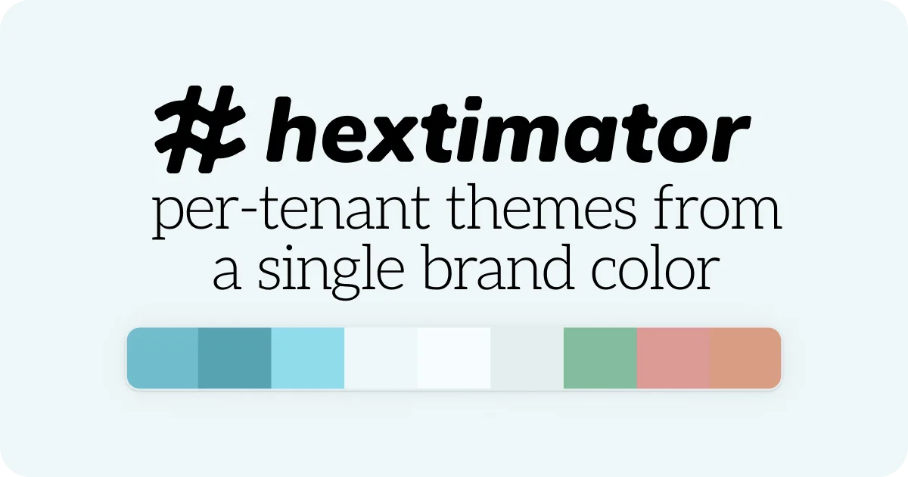

# hextimator

<p align="center">
    
</p>
<p>
  <a href="https://www.npmjs.com/package/hextimator"></a>
  <a href="https://github.com/fgrgic/hextimator/actions/workflows/test.yml"></a>
  <a href="https://github.com/fgrgic/hextimator/blob/main/packages/hextimator/LICENSE.md"></a>
  <a href="https://bundlejs.com/?q=hextimator&treeshake=[{hextimate}]"></a>
</p>

Runtime theming for multi-tenant apps.

Your customers pick a brand color; your app always looks good. No per-customer design reviews. No manual tuning. Yellow does not break your UI.

Each call takes under a millisecond (~0.4ms [^perf]). Same color and options always produce the same tokens. Run it on the request path. Cache it if you want.

~12 kB min+gzip. Zero dependencies.

Try it: **[hextimator.com](https://hextimator.com)**

## Why `hextimator` exists

<p align="center">
  <video src="https://github.com/user-attachments/assets/fec967e9-9e5d-4bb1-8e02-15fbc02afb0b" width="100%" controls playsinline></video>
</p>

You ship a B2B, B2B2C, or white-label app. Every tenant brings a brand color. Your choices today:

- **Let them pick any hex.** Legal-pad yellow buttons become unreadable. Cheeto tangerine toasts look like your warning state.
- **Curate a palette.** You tell a paying customer their brand color is not allowed.

hextimator is the third option. **One color in, whole theme out.** Light and dark. Semantic roles and surfaces. Foregrounds meet WCAG contrast by default (AAA unless you opt down). Even yellow.

## How it compares

hextimator is not the first palette generator. It targets one job the others skip: arbitrary brand colors at runtime.

- **[Adobe Leonardo](https://leonardocolor.io)** Runtime contrast scales from arbitrary hex (`Theme` → `contrastColors`, target ratios). A construction kit: you wire roles, surfaces, and dark mode yourself. hextimator is one call with those built in.
- **[Material dynamic color](https://github.com/material-foundation/material-color-utilities)** Full theming from one seed color. Battle-tested on Android. Output follows Material's token scheme. Hard to use outside Material-shaped UIs.
- **[Radix Colors](https://www.radix-ui.com/colors)** Hand-tuned scales with strong semantics. Fixed curated set. Does not generate themes from arbitrary input.
- **[tints.dev](https://tints.dev) / [uicolors.app](https://uicolors.app)** Quick Tailwind shade scales from one color. Build-time only. No semantic roles, contrast guarantees, dark theme, or library API.
- **[culori](https://culorijs.org) / [chroma.js](https://gka.github.io/chroma.js/)** Color math and conversions. You build a generator with these. They are not generators.

Hand-crafting one brand's design system? Several of these beat hextimator. Color comes from user input (tenants, white-label customers, CMS authors)? That is hextimator's job.

## 30-second start

```bash
npm i hextimator
```

```ts
import { hextimate } from "hextimator";

const css = hextimate("#C0FFEE").format({ as: "css" });
```

One color in, light and dark CSS variables out. Ship them however you like: inline `<style>`, a `.css` file, an edge cache. No DOM, so it works with SSR.

React:

```tsx
import { HextimatorStyle } from "hextimator/react";

<HextimatorStyle color="#0FF1CE" />;
```

CLI: `npx hextimator '#BADA55'`

## Tailwind

```css
@import "tailwindcss";
@import "hextimator/tailwind.css";
```

```html
<button class="bg-accent text-accent-foreground">Save</button>
<p class="text-surface-foreground-negative">Payment failed</p>
```

Every class uses your brand color, run through the theme. Change the color at runtime and the classes follow.

## Theme

The theme decides what your brand color turns into. You can use it as is, add to it, or replace it.

### Use it as is

```ts
hextimate(accent).format();
```

You get five roles: `surface`, `accent`, `positive`, `negative`, and `caution`. Each has `DEFAULT`, `strong`, `weak`, `foreground`, and `foreground-weak`. The surface also gets readable colored text for each role, such as `surface-foreground-negative`. Plus `brand-exact`, your input color unchanged.

Every foreground meets WCAG AAA contrast against its background.

### Add to it

Spread `baseTheme` and add what you need:

```ts
import { baseTheme, hextimate, type ThemeDefinition } from "hextimator";

const theme = {
  ...baseTheme,
  roles: { ...baseTheme.roles, cta: { color: "#ee2244" } },
  tokens: [...baseTheme.tokens, { name: "ring", value: { from: "accent" } }],
} satisfies ThemeDefinition;

hextimate(accent, theme).format();
```

With Tailwind, keep `hextimator/tailwind.css` and register the new names:

```css
@theme inline {
  --color-cta: var(--cta);
  --color-cta-foreground: var(--cta-foreground);
  --color-ring: var(--ring);
}
```

### Replace it

Declare only what you want:

```ts
const theme = {
  roles: {
    page: { generate: "surface" },
    brand: { generate: "accent" },
    danger: { generate: "negative" },
  },
} satisfies ThemeDefinition;

hextimate(accent, theme).format(); // --page, --brand, --danger, ...
```

With Tailwind, generate the stylesheet from your theme in a build script and import it instead of `hextimator/tailwind.css`:

```ts
import { tailwindAliases } from "hextimator";

writeFileSync("src/hextimator-theme.css", tailwindAliases(theme));
```

Rerun it when the theme changes. Accent changes need no rebuild.

Ready-made themes for shadcn/ui, MUI, and a few styles live in `themes`: `hextimate(accent, themes.shadcn)`.

## Docs

- [Themes](https://github.com/fgrgic/hextimator/blob/main/packages/hextimator/docs/themes.md): every field, style, and format option
- [Built-in themes](https://github.com/fgrgic/hextimator/blob/main/packages/hextimator/docs/presets.md)
- [React](https://github.com/fgrgic/hextimator/blob/main/packages/hextimator/docs/react.md)
- [Color vision deficiency](https://github.com/fgrgic/hextimator/blob/main/packages/hextimator/docs/color-vision-deficiency.md)
- [Examples](https://github.com/fgrgic/hextimator/blob/main/packages/hextimator/docs/examples.md)
- [Migration](https://github.com/fgrgic/hextimator/blob/main/packages/hextimator/docs/migration.md)

## Contrast methodology

WCAG 2.x contrast ratios. AAA by default. Opt down with `minContrastRatio`. Audits and compliance tooling still measure this way.

APCA is the perceptual model in draft WCAG 3. Better for a lot of UI. Not what pass/fail checks ask for yet. Optional support is planned when WCAG 3 settles.

## Stability

The API follows strict semver. Theme fields, builder methods, options, formats, CLI flags, and token names only break in majors, with notes in migration.md.

Generated color values are a separate contract. Output is fully deterministic: same version, same color, same options, same tokens. The algorithm itself may improve in minors (wider hue ranges, better anchors), which changes the exact values a theme produces. Every such change is flagged in the changelog with how to opt back into the old behavior.

In practice:

- Pin an exact version if you cache or snapshot generated output.
- Patches only change generated values to fix bugs.
- Contrast guarantees hold across all releases. Whatever changes, foregrounds meet your configured minimum against their backgrounds.

## Contributing

Open issues and PRs at [github.com/fgrgic/hextimator](https://github.com/fgrgic/hextimator/issues).

[^perf]: Measured on Apple Silicon M2 Max with Bun. Ballpark only. Your hardware and runtime will differ.
